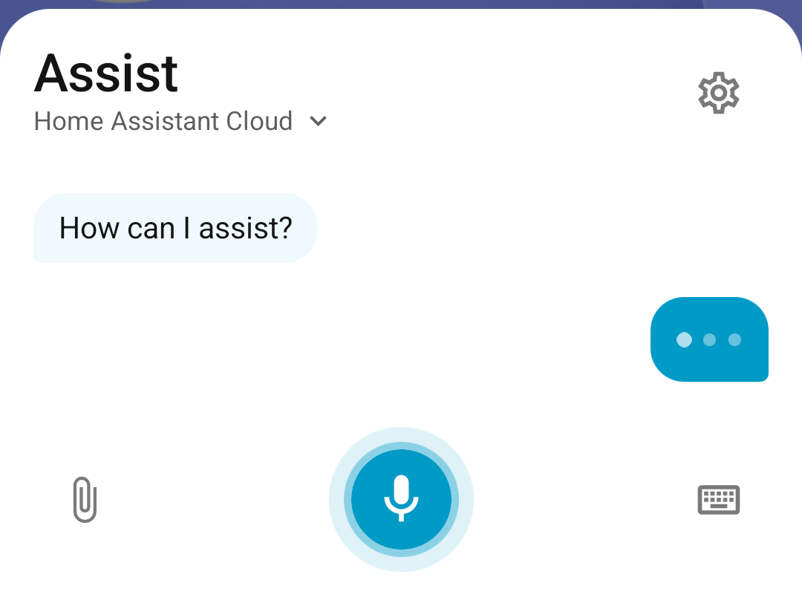
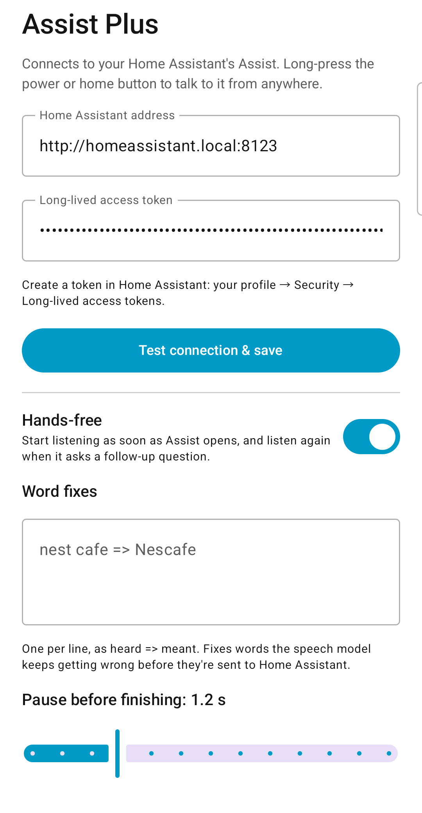
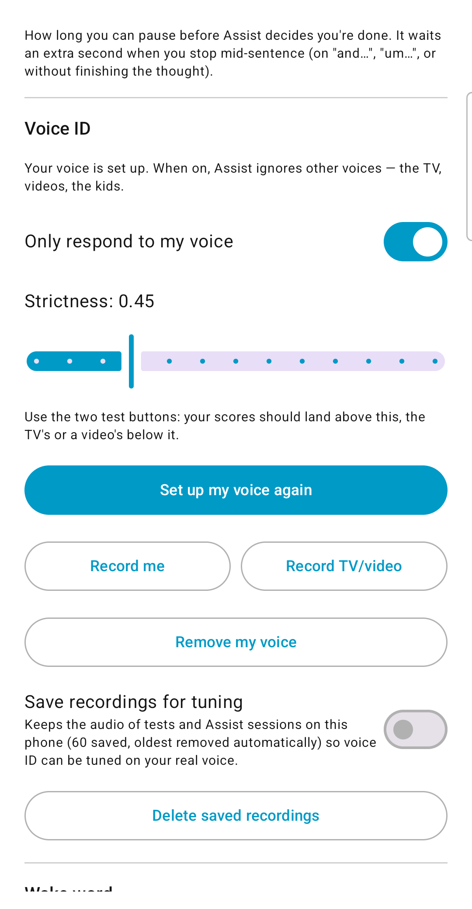
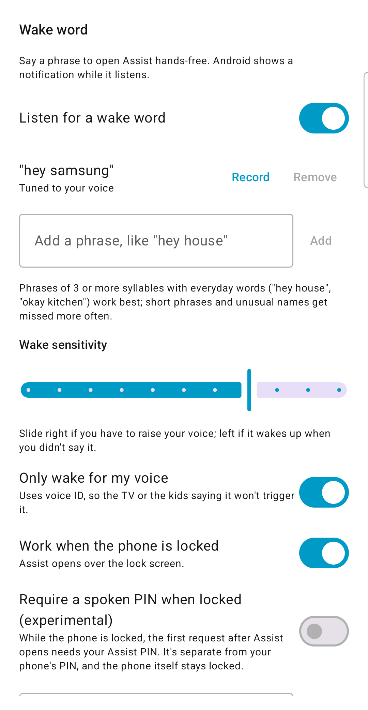
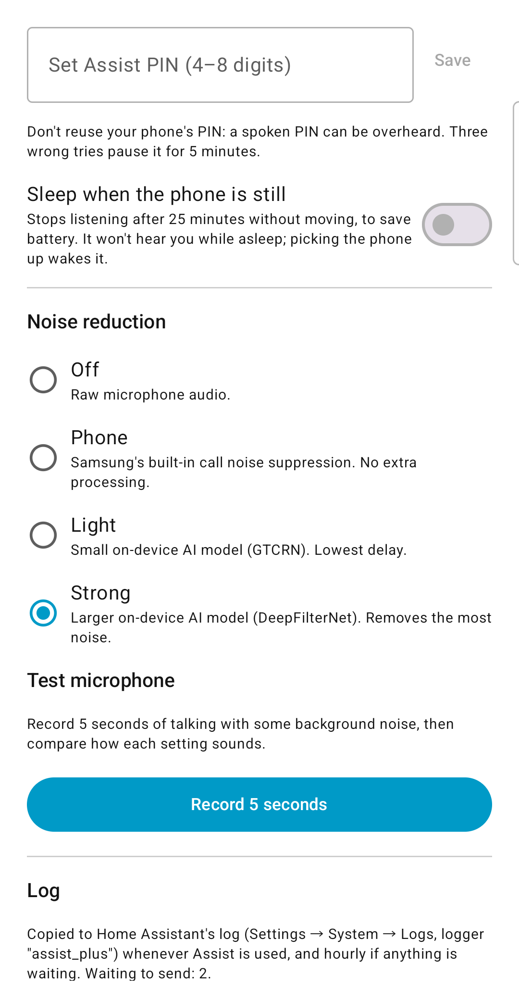

# Assist Plus

**A better voice client for Home Assistant's Assist on Android.** It keeps Home Assistant's own assistant and makes talking to it work in a real, noisy home: it listens on the phone, isolates *your* voice from the TV and the kids, shows your words as you speak, and lets you hand it photos, files and barcodes.

<p>
  
</p>
<p>
  
  
  
  
</p>

> I built this with Claude because I wanted the Assist experience to work for my family. I'm not a professional Android developer, so it isn't on the Play Store. It's fully open source: install the APK yourself, read the code, have Claude (or any AI) review it, and improve it. I'd love for ideas from here to make it into the official Companion app.

## What it does

- **Isolates your voice.** On-device noise removal plus voice ID: phrases from the TV, a YouTube video or the kids are dropped, and when a video runs straight into your sentence it's cut at the sentence break so only your words are sent.
- **Speech to text on the phone.** Your words appear on screen *as you speak*, not at the end. Home Assistant only ever receives text.
- **Better conversations.** Hands-free follow-ups, room to pause and think before it decides you're done, "cancel" / "never mind" to close it, and the agent can end the conversation itself.
- **Custom wake words.** Pick any phrase, record it a few times so it learns how you say it. Optional spoken PIN when the phone is locked (experimental).
- **Photos, files and barcodes.** Snap a barcode and say "I had one serving of this"; send a photo and say "remember this wine". The phone reads barcodes itself and looks them up in Open Food Facts; photos are described by your Home Assistant AI Task.
- **Looks like Home Assistant.** The Assist sheet copies the Companion app's design, and it uses your existing pipelines, agents and voices.

## How it works

```
Phone:  mic → noise removal → speech detection → live speech-to-text (Parakeet)
                                      ↓
                    voice ID (TitaNet): keep your phrases, drop other voices
                                      ↓
Home Assistant:            text → your Assist pipeline → conversation agent → reply (+ voice)
```

Everything that hears audio runs on the phone. Home Assistant gets the final text, plus anything you attach.

## Real numbers

Measured on a Samsung Galaxy S25 with a loud cooking video playing on a nearby computer.

**Voice ID: you vs. the video** (similarity to the owner's voiceprint, 5-second samples)

| Model | Owner | Video | Separates them? |
|---|---|---|---|
| WeSpeaker CAM++ (first try) | 0.38–0.60 | 0.57–0.63 | No — the video scored *higher* |
| **NVIDIA TitaNet small (used)** | **0.70–0.87** | **0.12–0.16** | **Yes, wide gap** |

**What got sent with the video playing**

| What the mic heard | What Assist Plus sent |
|---|---|
| "…or lentils. Hey, what do we want for dinner tonight" | "Hey, what do we want for dinner tonight?" |
| "…vegetables containing fats. Hey, I really want to have Taco Bell for dinner. What do I need to do to do that?" | "Hey, I really want to have Taco Bell for dinner. What do I need to do to do that" |
| "That's the bad news today. Hey, can we go to the store today?" | "Hey, can we go to the store today" |
| "Squeeze lemon juice over lentils. Add tomatoes to chickpeas…" (video only) | *(nothing — ignored)* |

Before this, with speech-to-text in the cloud and no voice filtering, the same setup sent: *"And basically McNugget ever fresh from McDonald's, but actually this is just a test, so don't save this as a memory I'm gonna add one pound of softened butter here, and I'm gonna grate in one clove of…"* — the video and the speaker mixed together.

**Speed**

| Step | Time |
|---|---|
| Noise removal (Strong) | 10 ms delay, ~10% of one CPU core |
| Speech-to-text of a whole command (Parakeet, on phone) | 30–80 ms |
| Live words on screen | refreshed every 0.4 s while you talk |
| Deciding you're done | 1.2 s after a finished sentence (adjustable), +1 s if you trail off |
| Splitting a phrase where another voice runs into yours | 0.1–1 s, only when needed |
| Models loading on first open | 1.5–3.5 s (the mic records meanwhile, nothing is lost) |
| The agent's reply | depends on your agent; typically 1.5–5 s for a cloud LLM |

## Install

1. Download the latest **`assist-plus-*.apk`** from [Releases](../../releases/latest) on your Android phone (Android 8+, 64-bit).
2. Open it and allow installing from your browser or file manager. Android may warn about an unknown developer; that's normal for apps outside the Play Store. On Samsung phones, turn **Auto Blocker** off while installing (Settings → Security and privacy → Auto Blocker), then back on.
3. Updates: install the new APK over the old one, or use [Obtainium](https://github.com/ImranR98/Obtainium) to get them automatically from this repository's releases.

## Setup

### 1. Home Assistant (2025.8 or newer recommended; developed on 2026.9)

1. **Reach Home Assistant from your phone.** At home, the local address works (`http://homeassistant.local:8123`). To use it away from home, use [Home Assistant Cloud (Nabu Casa)](https://www.nabucasa.com/) and its remote address (`https://….ui.nabu.casa`), or your own HTTPS address.
2. **Add an AI conversation agent** (strongly recommended). Settings → Devices & services → **Add integration** → **Anthropic** (Claude), **OpenAI**, **Google Gemini**, or **Ollama** for local. Home Assistant's built-in agent works too, but only for fixed device commands.
3. **Create or edit an assistant.** Settings → **Voice assistants** → your assistant (or **Add assistant**):
   - **Conversation agent:** the AI agent from step 2. Turn on "Prefer handling commands locally" if you like.
   - **Text-to-speech:** Home Assistant Cloud, **ElevenLabs** (Add integration → ElevenLabs), Google, or local **Piper** (Settings → Apps → Piper). Pick a **voice** — Assist Plus speaks replies with it.
   - **Speech-to-text:** not used by Assist Plus (the phone does it), but keep one if you also use the Companion app.
4. **Expose your devices.** Settings → Voice assistants → **Expose** tab → turn on the entities the assistant may control.
5. **For photos (optional):** an **AI Task** that can look at images. The Anthropic, OpenAI and Google integrations add one (Settings → Devices & services → your AI integration → AI Task). Without it, photo options are greyed out; barcodes and text files still work.
6. **Create an access token.** Click your profile (bottom left) → **Security** → **Long-lived access tokens** → **Create token**. Use an **admin** user (needed for photo uploads and the app's log). Copy it — it's shown once.

### 2. The phone

1. Open **Assist Plus**, enter your Home Assistant address and token, tap **Test connection & save**, and pick your assistant (pipeline).
2. **Make it the default assistant:** tap **Open default apps settings** → **Digital assistant app** → **Assist Plus**. On Samsung phones, also set **Settings → Advanced features → Side button → Press and hold → Digital assistant**.
3. Long-press the side/power button (or home) and talk. You can switch assistants from the sheet's title.
4. **Voice ID (recommended in a busy house):** Voice ID → **Set up my voice** (six short commands, normal distance), then **Only respond to my voice**.
5. **Wake word (optional):** Wake word → add a phrase (3+ syllables of everyday words work best), tap **Record**, allow **open over other apps**. Android shows a notification while it listens.

The Home Assistant Companion app keeps working as before for dashboards, notifications and location — Assist Plus only replaces the assistant panel.

## Recommended agent instructions

Paste this into your conversation agent's instructions (Settings → Devices & services → your AI integration → the conversation agent → configure), then add your own personality and details:

```
You are the voice assistant for this home. Replies are spoken aloud: keep them to one or two short sentences, with no lists or markdown.

Requests come from a phone app that filters out background voices, but words can still be misheard. If a word doesn't fit, go with the most likely meaning of the whole request; never start a new topic from one odd word. If the request is unclear, ask one short question.

A message may end with notes in square brackets, like [Attached photo …] or [Scanned barcode …]. They describe what the user sent along with the request.

Only ask a follow-up question when it continues what the user asked. Don't offer unrelated tasks.

When the user is wrapping up (thanks, that's all, never mind, cancel, goodbye), give a brief sign-off and put [end] at the very end of your reply.
```

The `[end]` tag lets the app close the assistant when the conversation is over; it's removed before anything is shown or spoken.

## Privacy and security

- **Audio never leaves the phone.** Home Assistant receives text, the photos and files you choose to attach, and nothing else. Barcode numbers are looked up on Open Food Facts.
- **Your token** is kept in the app's private storage (Android backups are disabled for the app) and only sent to your Home Assistant.
- **The app's log** (requests, timings, voice ID scores) is copied into your own Home Assistant log under the `assist_plus` logger, so problems can be diagnosed. A spoken PIN is never logged, saved or shown.
- **Recordings for tuning** are off by default and stay on the phone if you turn them on.
- **Spoken PIN** (experimental) is separate from your phone's PIN and stored only as a salted hash; three wrong tries pause it for 5 minutes. The phone itself stays locked — no app can unlock Android.
- **Use HTTPS away from home.** Plain `http://` is allowed so local addresses work.
- **Permissions:** microphone (listening), notifications and foreground service (wake word), display over other apps (wake word opening Assist), camera is not requested (photos use the camera app and the photo picker).

This app had a quick security review while it was built (for example, other apps can't fake a wake-word launch to open it over the lock screen), but **no professional audit**. The code is small and readable — ask Claude or another AI to review it before you install if you want a second opinion, and open an issue if you find something.

## Build from source

Requires JDK 17 and the Android SDK (command-line tools are enough).

```bash
./scripts/download-models.sh        # speech engine + models from their publishers (~230 MB)
./gradlew assembleDebug             # app/build/outputs/apk/debug/app-debug.apk
```

## Contributing and ideas

Fork it, improve it, send pull requests, or take the ideas to the [Home Assistant Companion app](https://github.com/home-assistant/android). Things I'd like next:

- **Phone actions:** "take me to Target on Main Street" → Google Maps navigation; "play my driving playlist on Spotify"; timers — handled on the phone, no Home Assistant round trip.
- Models downloaded on first launch instead of bundled (smaller APK).
- More languages (the models are English-only today).

## License

[Apache-2.0](LICENSE). See [THIRD_PARTY.md](THIRD_PARTY.md) for the libraries and models this builds on. Not affiliated with or endorsed by Home Assistant or Nabu Casa.
